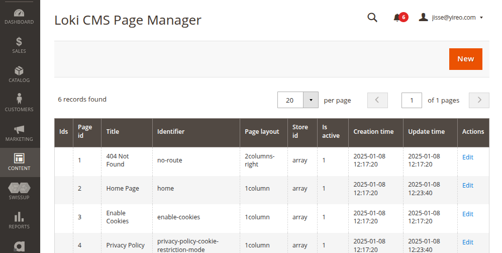

# YireoTraining_ExampleLokiAdminCmsPage

<!-- badges.specs.start -->
<div class="github-specs-badges">


</div>
<!-- badges.specs.end -->


**This Magento 2 module demos the usage of [Loki_AdminComponents](https://github.com/LokiExtensions/Loki_AdminComponents) to code a grid with ease.**

### Installation
```bash
composer require yireo-training/magento2-example-loki-admin-cms-page@dev
bin/magento module:enable YireoTraining_ExampleLokiAdminCmsPage
```
### Usage
Navigate via the menu **Content > Pages (Loki)**.

Note that this example module is not about the usage, it is about the code. See how little code was involved to create this grid.



### Permissions
Next to the ACL resources of this module (**Content > Elements > Pages > Pages (Loki)**), saving requires `Magento_Cms::save`, deleting requires `Magento_Cms::page_delete` and changing design settings requires `Magento_Cms::save_design`. Only the content and SEO fields of a page can be edited; layout updates and design settings are kept as they are.

Adobe Commerce admin role scopes (website or store restrictions of AdminGws) are not supported by this example module: an admin user with access to this page can edit pages of every store view.

## Current status

<!-- badges.test.start -->
<div class="github-pipeline-badges">


</div>
<!-- badges.test.end -->
